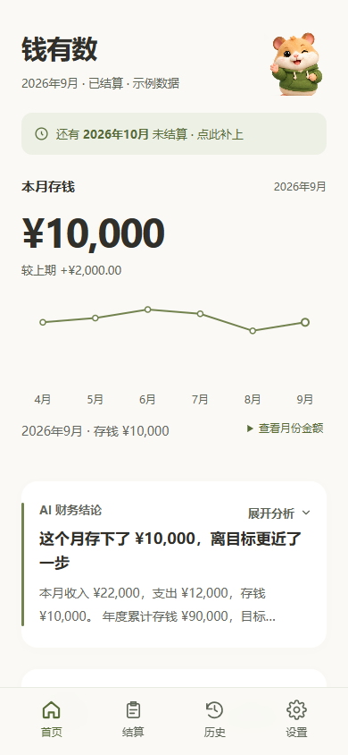
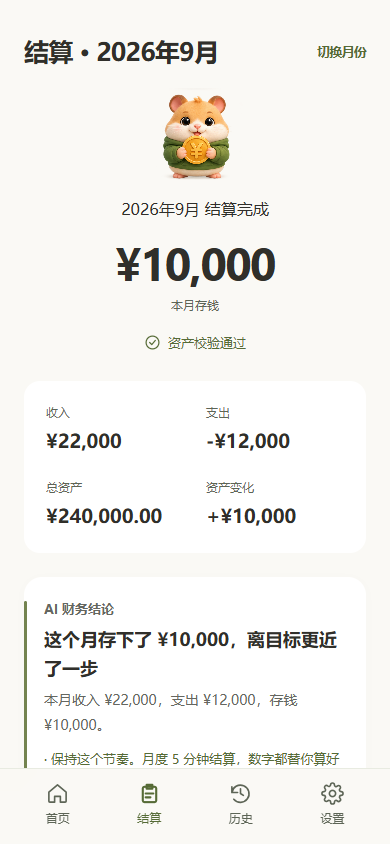
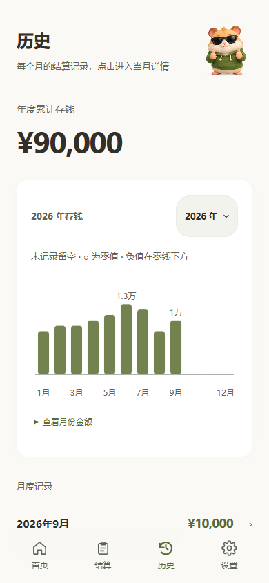

# 钱有数

**让每一分钱，都有数。**

钱有数是一款围绕「月度结算」设计的个人财务管理 Android 应用。记录收入与支出，盘点真实资产余额，回顾每月存下的钱，让财务变化看得清、查得到。

应用以小仓鼠「数数」为品牌角色，采用暖白与橄榄绿的界面，在录入、核对和完成等状态中提供适度提示。

当前版本：**v1.3.4**。

[构建说明](docs/BUILD.md) · [版本记录](CHANGELOG.md)

源码已提供，测试安装包待发布。

## 界面预览

以下图片使用虚构示例数据。

| 财务首页 | 月度结算 | 历史记录 |
| --- | --- | --- |
|  |  |  |

## 主要功能

### 月度结算与差异核对

- 按收入、支出、特殊事项、资产确认四步完成月度结算。
- 支持一句话录入收支、连续添加、修改与移除记录。
- 支持投资买卖、借出款和还款等特殊事项。
- 对照理论资产与实际盘点余额，提示需要进一步核对的差异。
- 从结算结果直接检查单项，查看后返回，修改后直接保存，无需重走完整流程。

### 财务概览与年度目标

- 查看本月存钱、趋势、总资产及资产构成。
- 回顾历史月份的结算记录与年度累计。
- 设置年度存钱目标，查看进度与预测；数据不足时明确展示相应状态。

### AI 辅助分析

- 支持月度财务总结、财务问答、收支及特殊事项识别、差异分析。
- 可配置 MiniMax 或 OpenAI 兼容接口，自行填写服务地址、模型与 API Key。
- Android 使用原生网络通道，提供连接测试、超时及具体错误提示。
- 财务数值由确定性规则计算；AI 用于辅助解释与识别。未配置或月度分析调用失败时，财务总结可使用内置规则。

### 本地记录与备份

- 财务记录存储在本机，支持 JSON 备份导出与导入。
- 按月份保留结算草稿，支持恢复未提交输入。
- 支持浅色、深色与跟随系统主题，以及自动过渡的启动动效。

## 使用方式

1. 首次打开时，录入期初资产，设置年度目标与财务偏好。
2. 结算时填写本月收入、支出和特殊事项，再确认各账户的真实余额。
3. 保存后查看本月结果；如有差异，可直接进入对应项目核对。
4. 如需 AI 功能，在设置中配置自己的模型服务，并测试连接。

本应用采用**资产盘点与核对模式**。记录一笔收入后，仍需在结算时填写相应账户的实际余额，以便检查是否存在漏记或盘点差异。

## 运行与安装

### Android

当前版本支持 Android 7.0（API 24）及以上系统。当前仓库已提供源码及构建说明，v1.3.4 测试安装包待发布。

- 项目名称：钱有数
- 应用包名：`com.qianyoushu.shushu`
- 当前版本：`1.3.4`，`versionCode 8`
- 更新时直接覆盖安装，保留相同包名与签名；不要先卸载。

当前 APK 使用 debug 签名，属于测试安装包，尚未作为应用商店正式版本发布。

### HTML

- 打开 `app/index.html`：从空数据开始使用。
- 打开 `app/preview.html`：使用虚构示例体验界面与流程。
- 如使用本地服务，可在项目根目录执行 `python -m http.server 8765 --directory app`，然后访问 `http://127.0.0.1:8765/`。

示例预览使用独立数据库，不会向正式空数据入口写入示例。网页 AI 接口仍受浏览器跨域策略影响，Android 原生请求通道仅在安装版中生效。

## 技术结构

| 目录 / 模块 | 用途 |
| --- | --- |
| `app/index.html` | 页面、业务流程及本地数据层入口 |
| `app/engine.js`、`app/db.js` | 财务计算和本地存储模块 |
| `app/redesign.*` | 品牌、布局、主题与IP状态展示 |
| `app/interactions.*` | 草稿、交互反馈与结算核对 |
| `app/charts.js` | 响应式图表与稀疏数据状态 |
| `app/ai-network.js` | AI请求与错误处理 |
| `android/` | Java / Android WebView 安装外壳和原生AI网络桥 |
| `docs/` | 实现、审计与验证说明 |

界面采用 HTML、CSS 与 JavaScript，本地数据使用 IndexedDB。正式 Android 网页资源由白名单脚本暂存后打包，安装包不包含示例数据入口脚本。

## v1.3.4 更新

- 结算结果的单项检查支持直接返回或保存返回。
- 未保存修改保留本机草稿，可继续核对。
- 四个手动核对按钮统一尺寸、图标与两列布局，AI辅助入口单独呈现。
- 保留首次结算的四步流程、资产核对操作和原财务计算规则。

## 验证与当前边界

v1.3.4已有验证记录：52项浏览器专项检查、18个页面/状态回归、32条财务规则及20项Android模拟器检查通过。

- 这些记录不代表已覆盖所有手机型号；当前版本仍需持续进行物理手机体验验证。
- 云同步尚待对接，不作为当前可用能力宣传；建议自行保留备份。
- AI服务的可用性取决于所配置平台、模型权限、网络和额度。启用相关功能时，请求所需的记录或汇总会发送给用户配置的服务。
- 财务分析与预测用于个人记录和回顾，不保证投资收益。

项目仍在持续迭代，欢迎提交可复现的问题与体验建议。
